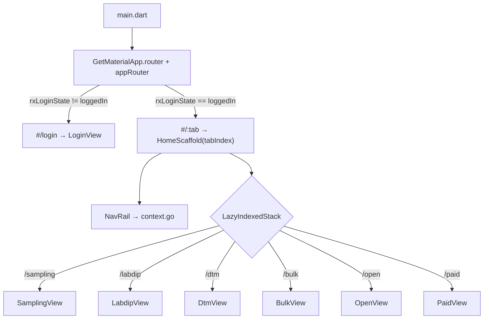
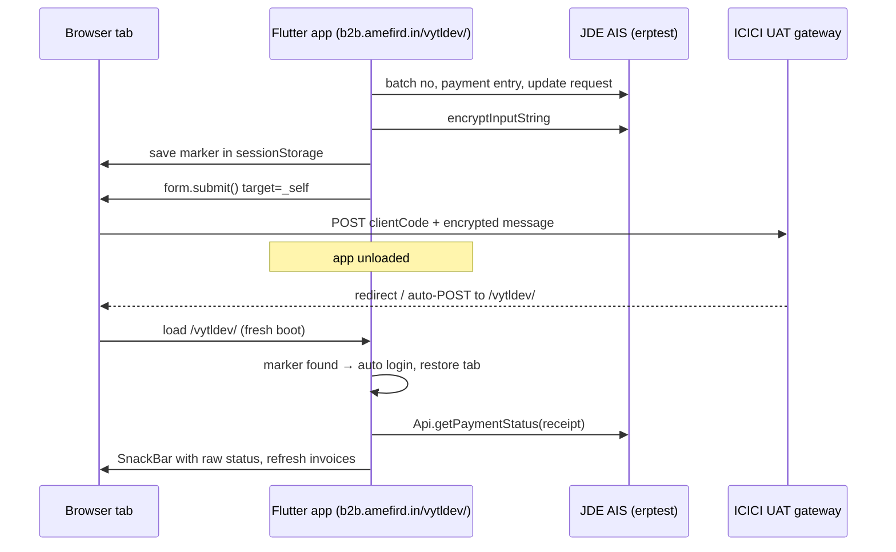

# Navigation

How the user moves through the Vardhman B2B app, and what happens when they
leave for the ICICI payment gateway and come back through the return / cancel
URL.

## 1. Routes

Routing uses **go_router** (`lib/app/app_router.dart`), plugged into
`GetMaterialApp.router` (`lib/app/app.dart`). The router shares GetX's
navigator key (`Get.key`), so `Get.dialog`, `Get.back()` and
`Get.showSnackbar` work as before.

| URL | Shows |
|---|---|
| `#/login` (`?from=/open`) | Login flow, switched by `rxLoginState` |
| `#/sampling` `#/labdip` `#/dtm` `#/bulk` | Orders tabs (nav rail index 0–3) |
| `#/open` `#/paid` | Payments tabs (nav rail index 4–5) |

The URL uses Flutter web's default hash strategy, so the server only ever sees
the app root (`/` or `/vytldev/`), and the gateway's `POST /vytldev/` handling
is unchanged.

| State | Owner | Decides |
|---|---|---|
| `rxLoginState` | `LoginController` (`lib/login/login_controller.dart`) | Login flow vs. home (via the router's redirect) |
| The URL | go_router | Which tab the home shows |
| `rxNavRailIndex` | `HomeController` (`lib/home/home_controller.dart`) | Mirrors the URL's tab for code that reads it (payment dialogs); set before login to pick the tab after a payment return |
| `Get.dialog` / `Get.back()` | Router's root navigator | Dialogs on top of a tab |

The router's redirect:

- **Not logged in:** any URL goes to `/login`. A tab URL is kept as `from`
  (`/login?from=/open`).
- **Logged in, on a tab URL:** shown as is.
- **Logged in, anywhere else** (`/login`, the bare app URL after the gateway
  return, an unknown path): goes to `from` if it is a tab, otherwise to the
  tab in `rxNavRailIndex` (the payment-return marker's tab, or Sampling).

So a **refresh keeps the tab** (after the password, as before), **browser back /
forward moves between tabs**, and **locking and logging back in returns to the
same tab**. The URL alone never logs anyone in: skipping the password still
needs the payment-return marker (5.3).

Every tab is one page with a fixed key, so switching tabs updates the same
`HomeScaffold`. Tabs visited once are kept alive (`LazyIndexedStack`,
`lib/home/lazy_indexed_stack.dart`), so going back to one is instant and keeps
its scroll position.



## 2. Startup and login flow

`main()` registers `SharedPreferences`, `ThemeController`, `Database` and
`LoginController` as permanent GetX services, then calls `runApp(App())`.

`LoginController` runs `_checkUser()` right away:

```
rxLoginState = unknown
      │
      ▼ _checkUser()
read UserDetails row from drift DB
      │
      ├─ no saved user ──────────────► loggedOut   (enter customer id)
      │                                   │ validateUser()
      │                                   ▼
      │                                 otp        (validateOtp)
      │                                   ▼
      │                               setPassword  (setPassword)
      │                                   │
      └─ saved user + saved password ─► password   (validatePassword)
                                          │
                                          ▼ _logIn → _registerSession
                                       loggedIn ──► HomeScaffold
```

`_registerSession` deletes and recreates every feature controller
(`UserController`, `CatalogController`, `OrdersController`, `DtmController`,
`SamplingController`, `LabdipController`, `BulkController`,
`InvoicesController`, `HomeController`). Because of this, **`rxNavRailIndex`
goes back to `0` (Sampling) on every login**, but the router then opens the tab
from the URL (`/login?from=…`) when there is one.

`lockUser()` sends the user back to the `password` screen. `forgotPassword()`
sends them back to `loggedOut`.

## 3. Home: the nav rail

`HomeScaffold` (`lib/home/home_scaffold.dart`) gets the tab index from the
route and shows `NavRail` next to a `LazyIndexedStack` of the six tab views.
`NavRail` (`lib/home/nav_rail.dart`) draws **two** `NavigationRail`s that
share the one index, and selecting an item calls `context.go` with the tab's
path from `homeTabPaths`:

| Rail | Items | Index (path) |
|---|---|---|
| Orders | Sampling, Labdip, DTM, Bulk | `value` (0–3) |
| Payments | Open, Paid | `value + 4` (4–5) |

Each rail shows as selected only when the index is in its own range
(`< 4` / `> 3`).

`OpenView` splits into `OpenInvoicesView` (invoice list) and
`InvoiceReviewView`. When `InvoicesController.rxLastPayment` is set,
`InvoiceReviewView` shows `PaymentKnockOffView` instead of the review.

## 4. Payment flow: leaving the app

There are two entry points, and both are dialogs opened from the Open tab:

| Dialog | File | Receipt | Gateway (PY / UAT) |
|---|---|---|---|
| Invoice payment | `lib/open/invoice_review_dialog.dart` | `P<batch>` | `https://digicxuat.icici.bank.in/finhub-collect/payment` |
| Advance payment | `lib/open/advance_payment_dialog.dart` | `M<batch>` | `https://generic.ipay2corpuat.icici.bank.in/gp2c-api/ws/payment` |

The sequence on **Proceed**:

1. `Api.fetchPaymentBatchNumber()` → `Api.createInvoicePaymentEntry(...)` (JDE)
2. Invoice flow only: `invoicesController.recordPayment(...)` saves the payment
   in `SharedPreferences`, so it is still there after the page reloads
3. `Api.updateInvoicePaymentRequest(sp: 'I')`
4. Build the request with `return-url` and `cancel-url` both set to
   **`https://b2b.amefird.in/vytldev/`**, the UAT deployment (see section 6).
   This is hard-coded in both dialogs and never points at the production root
5. `Api.encryptInputString(...)`
6. `savePaymentReturn(navRailIndex: ..., receiptNumber: ...)` writes the
   payment-return marker to the tab's `sessionStorage` (see 5.3)
7. Build an HTML `<form method="POST" target="_self">` in the DOM and
   `submit()` it
8. **The browser leaves the Flutter app.** The tab now shows ICICI, and the
   Flutter page, its memory and every GetX controller are gone



## 5. Coming back from the gateway

"This site can't be reached" (`ERR_CONNECTION_REFUSED`) does **not** mean the
Flutter app crashed. It means **no server was listening at the return URL**
when the browser got there.

### 5.1 Why localhost return URLs failed

The return URL used to be the app's own address (`Uri.base`, e.g.
`http://localhost:54870/`). With `flutter run -d chrome` the Flutter tool shuts
its dev server down once the tab navigates to ICICI (the debug connection
drops and it prints `Application finished.`). The port is also random on each
run. So on return there was nothing to answer. The return URL is now the
deployed UAT app instead (section 6), and the dialogs no longer use
`lib/common/app_url.dart` (`appReturnUrl`).

### 5.2 The gateway may POST to the return URL

Payment gateways usually come back with an **auto-submitted POST form**
carrying the encrypted response, not a plain GET. Static servers often reject
that (Python `http.server` → `501`, nginx static → `405`). The server hosting
`/vytldev/` must answer `POST /vytldev/` by serving that folder's `index.html`,
or by redirecting it to a GET.

To check: open DevTools → Network, tick **Preserve log**, pay or cancel, and
look at the request to the return URL: its method and the status code.

### 5.3 Restoring the session and tab (`lib/common/payment_return.dart`)

The app boots from scratch on return. Without help, the user would have to log
in again (`rxLoginState` → `password`) and would land on **Sampling**
(`rxNavRailIndex` → `0`). The payment-return marker fixes that:

1. **Before leaving** (step 6 above), `savePaymentReturn` writes
   `{navRailIndex, receiptNumber, savedAt}` as JSON to
   `window.sessionStorage['paymentReturn']`. sessionStorage belongs to the tab
   and the origin, so it survives the round trip to ICICI as long as the user
   comes back to `b2b.amefird.in` in the same tab.
2. **On boot**, `LoginController._checkUser` refreshes the token. If a marker
   less than 30 minutes old exists (`pendingPaymentReturn`), it calls `_logIn`
   straight away, skipping the password screen.
3. `_registerSession` sets `rxNavRailIndex` to the saved tab (normally `4`,
   Open). The gateway returns to the bare app URL, which has no tab in it, so
   the router's redirect sends the user to that tab (`#/open`). The return URL
   could carry the tab itself (`…/vytldev/#/open`), but only once ICICI has
   confirmed it accepts that URL.
4. After login, `_checkPaymentStatus` calls
   `Api.getPaymentStatus(receiptNumber)` (`ORCH55_GetPaymentWrapper`), logs the
   decrypted text and shows it in a SnackBar. For now this is only to learn
   the format; invoice state is not changed from it. Then it refreshes the
   invoices and clears the marker, so a reload does not repeat the check.
5. **Failed or cancelled payment.** The gateway comes back with
   `?errorStatus=1&errorMessage=Payment+Failed` (success is `errorStatus=0`).
   `gatewayResultOf` reads this before the query is cleared, and any status
   other than `0` counts as failed. The user is still logged back in on the
   Open tab, but sees a red "Payment not completed" toast with the gateway's
   message instead of the green status, and the payment saved before leaving
   (`rxLastPayment`, same receipt) is dropped so `PaymentKnockOffView` does
   not show it. If no marker is pending, the red toast is shown on the login
   screen. JDE is not told about the failure: the entry stays at
   `updateInvoicePaymentRequest(sp: 'I')`.

Every sessionStorage read and write is wrapped in try/catch. If storage is
unavailable, the getters return `null` and the user gets the normal login
screen. Return and cancel use the same URL, so both are handled the same way.

`rxLastPayment` (from `SharedPreferences`) still drives `PaymentKnockOffView`
on the Open tab, which reads the knock-off per invoice from JDE.

## 6. UAT setup at `/vytldev/`

The production app is at the root, `https://b2b.amefird.in`, and uses
production JDE and the real OTP. A UAT (PY) payment must never return there,
so the PY build is hosted separately under `/vytldev/` on the same domain.
Being on the same origin also keeps the sessionStorage marker readable.

| | Production (PD) | UAT (PY) |
|---|---|---|
| App URL | `https://b2b.amefird.in/` | `https://b2b.amefird.in/vytldev/` |
| Base href | `/` | `/vytldev/` |
| JDE (`lib/api/api.dart`) | `erp.vardhmanthreads.in` | `erptest.vardhmanthreads.in` |
| Invoice gateway | `generic.ipay2corp.icici.bank.in` (commented out) | `digicxuat.icici.bank.in/finhub-collect/payment`, client `WT-2519` |
| Advance gateway | `generic.ipay2corp.icici.bank.in`, `WT-1573` (commented out) | `generic.ipay2corpuat.icici.bank.in`, `WT-1474` |
| Return / cancel URL | `https://b2b.amefird.in` (commented out) | `https://b2b.amefird.in/vytldev/` |
| Invoice `txn-amount` | — | `"99.00"`, fixed on purpose for UAT testing |
| OTP | sent by SMS | hard-coded `1234` (`login_controller.dart`) |

The current code is set to **PY everywhere**. Switching to PD still means
commenting code in and out in `api.dart` and both payment dialogs.

### 6.1 Build

Run from **PowerShell**, not Git Bash. Git Bash rewrites `/vytldev/` into
`C:/Program Files/Git/vytldev/` and the build fails.

```powershell
.\scripts\build_web_uat.ps1
# or, if script execution is disabled:
powershell -ExecutionPolicy Bypass -File .\scripts\build_web_uat.ps1
```

The script runs `flutter build web --release --base-href /vytldev/` into the
default `build\web`, then moves it to `build\web_uat`. It does not use
`--output`, because with `--output` Flutter skips copying the files in `web\`
(`sqlite3.wasm`, `drift_worker.js`, `manifest.json`, `favicon.png`, `icons\`).
Without `sqlite3.wasm` and `drift_worker.js` the drift database fails at
startup.

Stop any running `flutter run` first. It can lock files under `build\`, and the
build then fails with "Flutter failed to delete …".

Before shipping, check that `build\web_uat` contains `sqlite3.wasm` and
`drift_worker.js`, and that `index.html` has `<base href="/vytldev/">`.

### 6.2 Package and deploy

Zip the **contents** of `build\web_uat` (no wrapper folder):

```powershell
Compress-Archive -Path .\build\web_uat\* -DestinationPath .\build\vytldev_uat_<date>.zip
```

On the server:

1. Extract the zip into the `/vytldev/` folder, so `index.html` is at
   `/vytldev/index.html`. Leave the production app at the root alone.
2. Make `POST /vytldev/` serve `/vytldev/index.html` (see 5.2).
3. Confirm with ICICI that `https://b2b.amefird.in/vytldev/` is an allowed
   return URL for `WT-2519` / `WT-1474`.

The repo has no server config for b2b.amefird.in (no `web.config`, nginx
config, Dockerfile or deploy script), so steps 2 and 3 have to be checked on
the server and with ICICI.

### 6.3 Testing the build locally

`scripts/payment_test_server.py` serves `build\web_uat` on port 8000. It strips
the `/vytldev` prefix so the build also works from `/`. For POST requests it
prints the first 500 bytes of the body (to see what the gateway sends) and
answers with a `303` redirect to `/`.

```powershell
py scripts\payment_test_server.py
Start-Process chrome -ArgumentList "--user-data-dir=$env:TEMP\vardhman_b2b_chrome_dev", "--disable-web-security", "http://localhost:8000/"
```

The Chrome profile with web security turned off is needed because JDE AIS
does not send CORS headers for localhost. Use it for development only. Port
8000 must be free.

A real gateway round trip still returns to `https://b2b.amefird.in/vytldev/`,
not to localhost, because that URL is hard-coded. The local server is for
checking the build and the POST handling.

## 7. Other things noticed in the payment code

- `Future.delayed(Duration(seconds: 3));` in `invoice_review_dialog.dart` is
  missing an `await`, so it does nothing.
- After `form.submit()` the code still calls `Get.back()` twice and shows a
  toast. The page is already unloading, so this has no effect, but it isn't
  harmful.
- PD / PY / GitHub settings are switched by commenting code in and out (gateway
  URL, client code, JDE base URL, return URL). It's easy to mix them up, e.g.
  the PY JDE host with the PD gateway, or a PY build returning to production.
